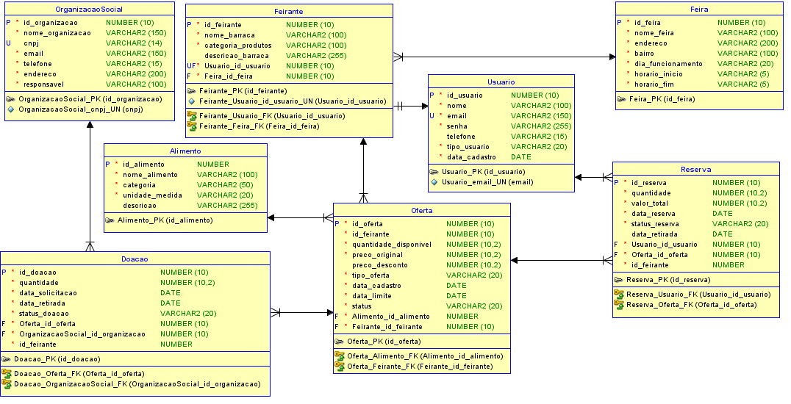

## Modelos Desenvolvidos

### Modelo Conceitual (DER)

O modelo lógico apresenta as entidades do sistema, seus atributos e relacionamentos.

### Modelo Relacional

O modelo relacional apresenta as tabelas, chaves primárias, chaves estrangeiras e restrições de integridade.

**Disciplina:** Building Relational Database

**Equipe:** Grupo Bem Coletivo

Projeto desenvolvido em equipe como parte das atividades acadêmicas do curso de Análise e Desenvolvimento de Sistemas.
