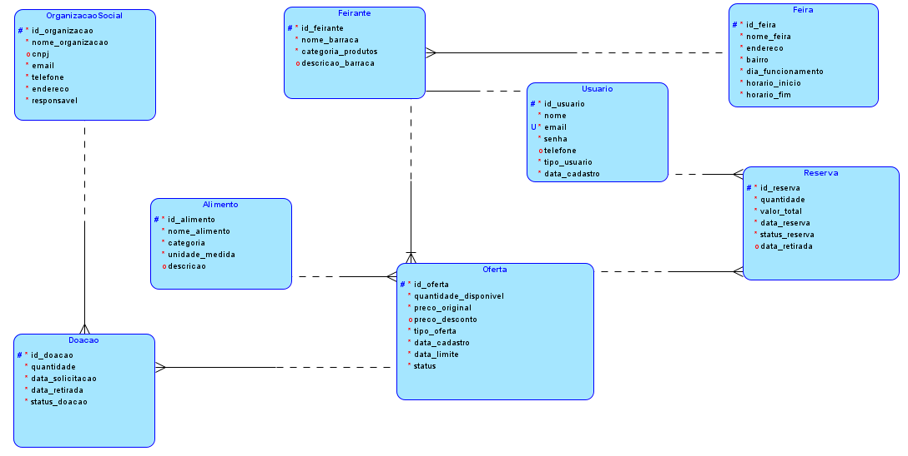

# FeiraCircular — Modelagem de Banco de Dados

### Redução do desperdício de alimentos nas feiras livres de São Paulo

Projeto acadêmico desenvolvido durante a Global Solution 2026/2 da FIAP, na disciplina de Building Relational Database.

## Sobre o Projeto

O **FeiraCircular** é uma proposta de plataforma digital que busca reduzir o desperdício de alimentos nas feiras livres de São Paulo, conectando feirantes, consumidores e organizações sociais.

Segundo uma [reportagem do Jornal da USP](https://jornal.usp.br/ciencias/ciencias-ambientais/toneladas-de-alimentos-das-feiras-de-sp-vao-para-o-lixo/), publicada em 2018, uma pesquisa estimou que aproximadamente 33 mil toneladas de alimentos eram descartadas anualmente nas feiras livres da cidade.

A solução propõe que alimentos excedentes, ainda próprios para consumo, possam ser comercializados com descontos ou destinados à doação.

Além de contribuir para a redução do desperdício, o projeto busca ajudar os feirantes a recuperar parte da renda que seria perdida com produtos não vendidos.

Este repositório apresenta a **modelagem conceitual e relacional do banco de dados** que poderá sustentar essa plataforma.

## Objetivos

- Reduzir o desperdício de alimentos nas feiras livres.
- Permitir a comercialização de excedentes com preços reduzidos.
- Facilitar doações para organizações sociais.
- Conectar feirantes, consumidores e instituições.
- Organizar o registro de ofertas, reservas e doações.
- Estruturar um banco de dados para apoiar o desenvolvimento futuro da plataforma.

## Tecnologias Utilizadas

- Oracle SQL Developer Data Modeler
- Modelagem conceitual de banco de dados
- Modelagem lógica relacional
- Diagrama Entidade-Relacionamento (DER)
- Conceitos de bancos de dados relacionais

## Estrutura do Banco de Dados

A modelagem foi desenvolvida com oito entidades principais:

| Entidade | Responsabilidade |
|---|---|
| USUARIO | Cadastro dos usuários da plataforma |
| FEIRANTE | Informações dos comerciantes e suas barracas |
| FEIRA | Cadastro e localização das feiras livres |
| ALIMENTO | Identificação e classificação dos alimentos |
| OFERTA | Registro dos produtos disponíveis para venda ou doação |
| RESERVA | Controle das reservas realizadas pelos usuários |
| ORGANIZACAO_SOCIAL | Cadastro das instituições participantes |
| DOACAO | Registro e acompanhamento das solicitações de doação |

## Relacionamentos

O banco de dados utiliza relacionamentos entre as entidades para garantir a organização e a integridade das informações.

Entre os principais relacionamentos estão:

- **USUARIO — FEIRANTE (1:1 opcional):** um usuário pode estar associado a um cadastro de feirante.
- **FEIRA — FEIRANTE (1:N):** uma feira pode possuir vários feirantes.
- **FEIRANTE — OFERTA (1:N):** um feirante pode cadastrar várias ofertas.
- **ALIMENTO — OFERTA (1:N):** um alimento pode aparecer em diferentes ofertas.
- **USUARIO — RESERVA (1:N):** um usuário pode realizar várias reservas.
- **OFERTA — RESERVA (1:N):** uma oferta pode receber várias reservas.
- **OFERTA — DOACAO (1:N):** uma oferta pode originar várias solicitações de doação.
- **ORGANIZACAO_SOCIAL — DOACAO (1:N):** uma organização pode solicitar várias doações.

## Regras de Negócio e Integridade

Foram definidas 18 regras de negócio para orientar o funcionamento da solução.

A modelagem contempla:

- Chaves primárias (PK) e estrangeiras (FK).
- Restrições `NOT NULL` para campos obrigatórios.
- Restrições `UNIQUE` para evitar registros duplicados.
- Restrições `CHECK` para validar quantidades e valores.
- Controle de estados das reservas e doações.
- Relacionamentos que preservam a integridade referencial.

Algumas validações, como a disponibilidade de estoque antes de confirmar reservas, estão previstas para uma futura implementação da aplicação.

## Modelos Desenvolvidos

### Modelo Lógico

O modelo lógico apresenta as entidades do sistema, seus atributos e relacionamentos.

### Modelo Relacional

O modelo relacional apresenta a estrutura das tabelas, chaves primárias, chaves estrangeiras e restrições de integridade.

## Como Abrir o Projeto

1. Baixe o arquivo [BancoDadosFeirasSP.zip](BancoDadosFeirasSP.zip) disponibilizado neste repositório.
2. Extraia seu conteúdo.
3. Abra o Oracle SQL Developer Data Modeler.
4. Selecione `File > Open`.
5. Localize e abra o arquivo `.dmd` do projeto.
6. Consulte os modelos lógico e relacional.

## Impacto e Proposta de Valor

O FeiraCircular busca gerar benefícios para diferentes participantes:

**Feirantes:** possibilidade de recuperar parte do valor investido em alimentos que não seriam comercializados.

**Consumidores:** acesso a alimentos com preços reduzidos.

**Organizações sociais:** acesso facilitado a alimentos destinados à doação.

**Meio ambiente:** redução do descarte desnecessário de alimentos.

A proposta está alinhada aos Objetivos de Desenvolvimento Sustentável (ODS) da ONU:

- **ODS 2:** Fome Zero e Agricultura Sustentável.
- **ODS 11:** Cidades e Comunidades Sustentáveis.
- **ODS 12:** Consumo e Produção Responsáveis.

## Status do Projeto

**Modelagem de banco de dados concluída.**

Foram desenvolvidos os modelos lógico e relacional utilizando o Oracle SQL Developer Data Modeler.

A implementação da plataforma digital, suas interfaces e funcionalidades operacionais são possibilidades de desenvolvimento futuro.

## Contexto Acadêmico

**Instituição:** FIAP — Faculdade de Informática e Administração Paulista

**Curso:** Análise e Desenvolvimento de Sistemas

**Projeto:** Global Solution 2026/2 — CitizenTech

**Disciplina:** Building Relational Database

**Responsável pela modelagem de banco de dados:** Arthur Lopes

---

Projeto acadêmico voltado à aplicação de conceitos de modelagem de dados para solucionar problemas reais relacionados à sustentabilidade e ao desperdício de alimentos.
